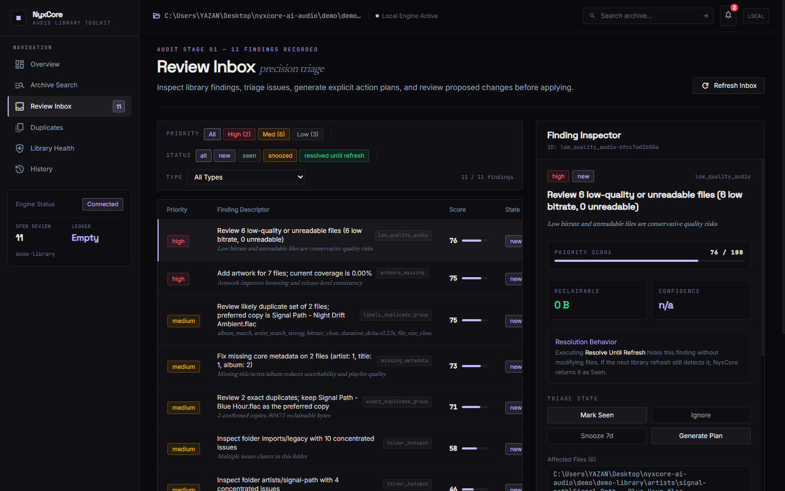
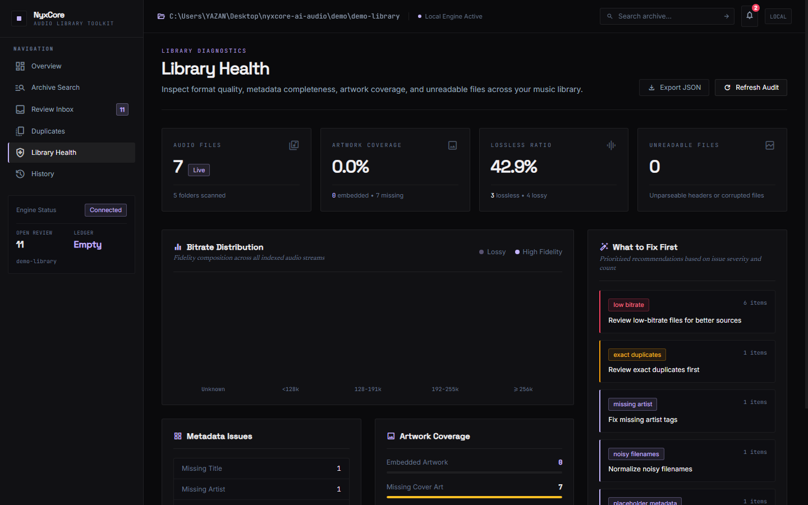
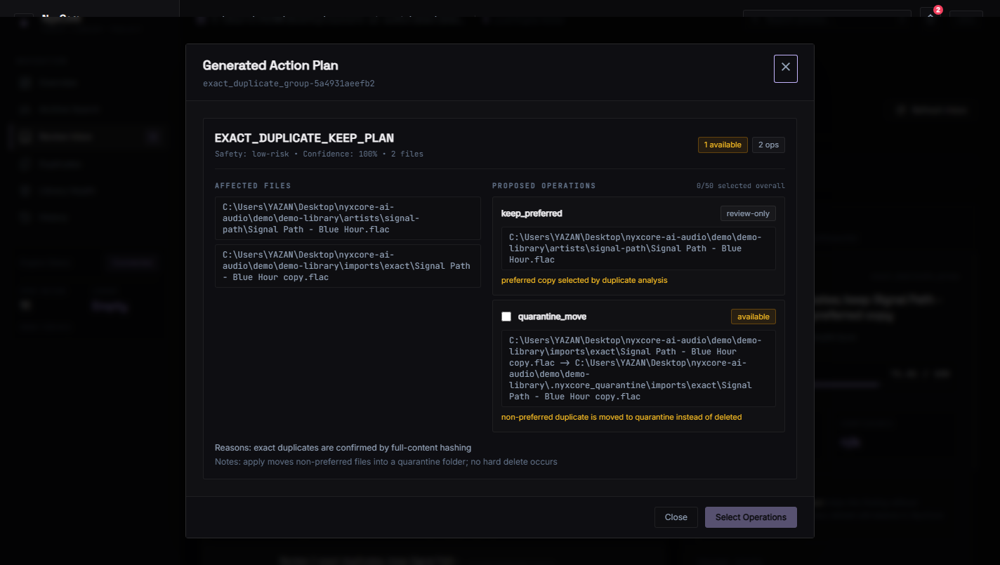
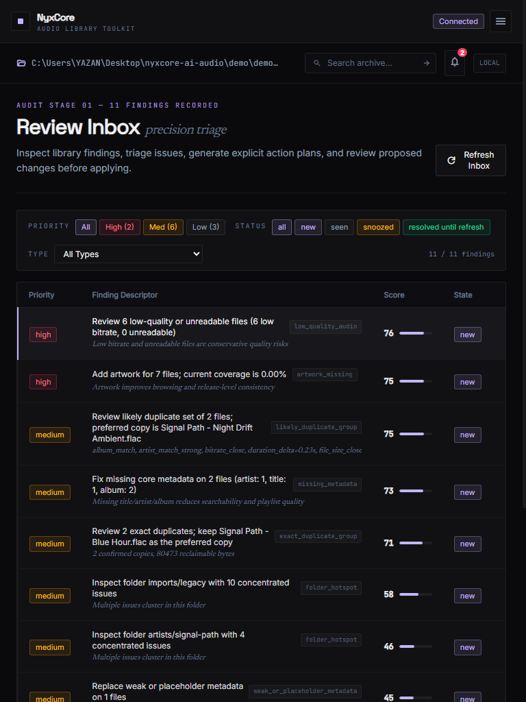

# NyxCore

> NyxCore is an experimental local-first music-library review toolkit for people who manage folders of audio files rather than streaming playlists.

NyxCore scans a local audio directory, surfaces duplicate and metadata health findings, builds an interactive review queue, generates explicit, inspectable action plans, and applies selected operations with journaling, single-writer locking, quarantine-based moves, and reversible history.

Everything runs against local files and local state. NyxCore does not require cloud accounts, remote media servers, or hosted databases.

Current release version: `0.3.0`


*NyxCore Review Inbox: inspect finding details, review generated plan operations, and selectively approve changes before execution.*

---

## Core Workflow

NyxCore enforces a strict review-first lifecycle:

```
scan
  → detect duplicate / health findings
  → review
  → generate explicit action plan
  → safely apply selected operations
  → inspect history
  → reverse when supported
```

1. **Scan**: Indexes audio files (`.mp3`, `.flac`, `.ogg`, `.m4a`, `.wav`, `.aif`, `.opus`), reading metadata tags and file characteristics using pure Python (`mutagen`).
2. **Detect Findings**: Runs duplicate analysis (exact SHA-256 and likely fuzzy metadata/duration matches) and library health checks (missing tags, placeholder values, low bitrates, missing artwork).
3. **Review**: Aggregates findings into a unified, prioritizeable review queue. Findings can be triaged without altering audio files.
4. **Plan**: Compiles approved review items into a serialized JSON action plan with explicit source paths, destination paths, field modifications, and cryptographic content fingerprints.
5. **Apply**: Executes selected plan operations under a library-scoped single-writer lock with durable intent journaling. Duplicate files are relocated to `.nyxcore_quarantine` rather than deleted.
6. **Inspect History**: Every applied batch is recorded in a local history ledger with execution timestamps, per-operation statuses, and rollback fingerprints.
7. **Reverse**: Supported operations (such as metadata updates and quarantine moves) can be undone or restored after verifying that files have not been modified externally.

---

## Approved Public Surfaces

The web interface exposes six approved public views:

| Route | Surface | Purpose |
|---|---|---|
| `/` | **Overview** | Library summary metrics, finding category distributions, recent activity, and quick access. |
| `/search` | **Archive Search** | Unicode-normalized, read-only search across filenames, tags, genres, and directory paths. |
| `/review` | **Review Inbox** | Central triage and plan execution workbench with expandable finding cards and plan previews. |
| `/duplicates` | **Duplicates** | Dedicated exact and likely duplicate clusters with track comparisons and review links. |
| `/health` | **Library Health** | Detailed integrity diagnostics: missing metadata, placeholder tags, artwork gaps, low bitrates. |
| `/history` | **History** | Chronological audit log of applied operation batches with reversal inspection and undo actions. |

> **Scope Note**: A saved-playlists query backend exists in the codebase for experimental research, but its web UI route (`/playlists`) is deferred and intentionally unexposed in this release.

---

## Safety Architecture & Limitations

NyxCore is designed around defensive, local-first safety primitives:

- **Explicit User Review**: No autonomous or background mutations. Every file modification or relocation requires an explicit action plan generated from human review.
- **Serialized Action Plans**: Plans are written to `review_plan.json` with strict operation schemas, preflight validation, and content fingerprints. Plans exceeding 50 operations are flagged for mandatory manual review.
- **No-Clobber Quarantine**: Duplicate removals never delete files directly. Non-preferred copies are moved into `.nyxcore_quarantine/` with collision-safe naming. Normal scans ignore quarantine folders.
- **Intent Journaling** for apply and reversal records each intent before changing an audio file. Interrupted operations can be reconciled when the paths, fingerprints, and recorded file identity support the same conclusion.
- **Single-Writer Locking** coordinates NyxCore writers through the library's `.nyxcore_mutation.lock`. An abandoned lock requires operator review.
- **Recovery Inspection** with `recover-review-action --action inspect` reports ambiguous states for manual review. Older interrupted moves without recorded file identity need manual review when a destination exists.
- **Reversal Verification** checks the live file's SHA-256 fingerprint. Metadata restoration also verifies the backup and a staged copy before atomically replacing the live file.
- **Metadata Backups**: Pre-edit metadata states are preserved in `.nyxcore_backups/` before in-place tag updates.

### Important Limitations

> [!WARNING]
> **No ACID Guarantees**: NyxCore operates directly on local filesystems. It does not provide distributed transactions, two-phase commits, or atomic directory swapping.
>
> **Concurrent filesystem changes** can occur after a path or fingerprint check and before the next filesystem call. The library lock coordinates NyxCore writers. It cannot coordinate other programs that edit files or replace paths. Keep other writers away from disposable mutation fixtures.
>
> **Disposable-library validation** covered CLI, API, browser apply and reversal, and interrupted recovery on Ubuntu 24.04 under WSL2 on ext4. Native Windows 11 on NTFS with Python 3.12 also passed quarantine, metadata restore, lock exclusion, and controlled interruptions after journal intent, hard-link creation, and reversal before result persistence. Abrupt native process termination, power loss, and filesystem crash durability remain unverified. An interruption during metadata staging can leave a temporary file for manual inspection. Older builds should not resume batches written with pending reversal intent.
>
> **Experimental use** on real music libraries is limited to read-only review and plan preview. Use synthetic or disposable libraries for mutation testing.

---

## Screenshot Showcase

### Overview

*Overview dashboard displaying library scan status, finding counts, and direct navigation.*

### Duplicates Analysis

*Duplicates view showing exact SHA-256 and likely duplicate groups with comparison metrics.*

### Library Health

*Health diagnostic report detailing missing tags, placeholder titles, artwork coverage, and bitrate distribution.*

### Operation History & Reversal

*Audit history displaying executed batches, affected paths, and reversible action controls.*

### Action Plan Review Modal

*Focus-trapped dialog displaying generated action plan operations, individual operation selection checkboxes, and preflight safety checks.*

### Tablet & Responsive Support

*Responsive layout verified across tablet and mobile viewports with accessible focus styling.*

*For the complete gallery of release screenshots and responsive verification captures, see [`screenshots/README.md`](screenshots/README.md).*

---

## Requirements

- **Python**: `3.11` or `3.12` are tested. The package minimum is `3.11`.
- **Node.js for frontend builds and development**: Use Node.js 22.13 or later within 22.x and npm. The launcher uses the compiled assets at runtime.
- **Audio Metadata Support**: Pure Python via `mutagen` (`.mp3`, `.flac`, `.ogg`, `.m4a`, `.wav`, `.aif`, `.opus`). No external media binaries are required for core indexing, health reporting, duplicate matching, or action plans.
- **Optional External Tools**:
  - `ffmpeg`: **Only** required if you want to generate synthetic audio test files with `demo/create_demo_library.py` or run optional CLAP audio transcoding. It is not required for the core scanner or web application.

---

## Native Windows Quickstart

Use Windows 11, Python 3.12, and Node.js 22 (22.13 or later within 22.x). Put FFmpeg on PATH to generate the synthetic library. These PowerShell commands set up the launcher in a source checkout.

```powershell
git clone https://github.com/DRGYZ/nyxcore-ai-audio.git
Set-Location nyxcore-ai-audio
py -3.12 -m venv .venv
.\.venv\Scripts\python.exe -m pip install -e '.[web]'
Push-Location web
npm.cmd ci --engine-strict
npm.cmd run build
Pop-Location
```

Generate the demo once, then launch it.

```powershell
.\.venv\Scripts\python.exe demo/create_demo_library.py
.\.venv\Scripts\python.exe -m nyxcore.launch --demo --out data/demo-reports
```

NyxCore prints the configured library, workspace, and local URL, then opens the browser when ready. Check **Active library** in Overview. In **Review Inbox**, select the exact duplicate finding for **Blue Hour**, click **Generate Plan**, and inspect which copy would be kept and which would be moved.

To switch libraries, press **Ctrl+C** in the launcher terminal and restart with an explicit library and a separate workspace for that library.

```powershell
.\.venv\Scripts\python.exe -m nyxcore.launch --music 'D:\Music Library' --out 'C:\NyxCore\my-library-reports'
```

The launcher binds only to `127.0.0.1` and runs in **review-only mode** for every library. Search, findings, plan previews, and history inspection are available. Triage decisions and saved playlists may write local state to the workspace. The API refuses apply, restore, and undo requests. Mutations remain experimental.

- If the port is occupied, append `--port 8001` or choose another free port. Leave the existing service running.
- If the browser does not open, use the printed URL. Add `--no-browser` to open it yourself.
- If the build is missing or incomplete, repeat the commands in `web/`. After building, the launcher runs without Node.js or Vite. Keep `web/dist/` next to the Python source in the checkout.
- If the demo is missing, run the generator from the repository root. Choose an existing music folder and a writable workspace that does not overlap it.

For Ubuntu 24.04 under WSL2, follow the [WSL2 Setup Guide](INSTALL_WSL.md).

---

## Development Workflow

The separate Vite and FastAPI workflow is for development. Use disposable libraries with it. The [WSL2 Setup Guide](INSTALL_WSL.md) covers system prerequisites. Run the commands below in Bash inside the Linux environment.

### 1. Set Up Python

```bash
git clone https://github.com/DRGYZ/nyxcore-ai-audio.git
cd nyxcore-ai-audio

python3 -m venv .venv
source .venv/bin/activate
python -m pip install -e ".[web,dev]"
```

### 2. Generate the Demo and Reports

With `ffmpeg` on PATH, generate the synthetic fixture. If you already generated it at this path, skip the first command.

```bash
python demo/create_demo_library.py
python -m nyxcore.cli scan demo/generated/sample-library --out data/demo-reports
python -m nyxcore.cli duplicates demo/generated/sample-library --out data/demo-reports
python -m nyxcore.cli health demo/generated/sample-library --out data/demo-reports
python -m nyxcore.cli review demo/generated/sample-library --out data/demo-reports
```

The fixture has seven tracks, one exact duplicate group, and one likely duplicate group. The CLI writes reports and local state under `data/demo-reports/` without changing audio files. The API computes findings from the configured library and reads local review state; it does not load the CLI reports as snapshots.

### 3. Launch the Web API

From the repository root with the virtual environment active:

```bash
export NYXCORE_WEB_MUSIC_DIR="$(pwd)/demo/generated/sample-library"
export NYXCORE_WEB_OUT_DIR="$(pwd)/data/demo-reports"
uvicorn nyxcore.webapi.app:app --reload --host 127.0.0.1 --port 8000
```

Open [API status](http://127.0.0.1:8000/api/status) and check that `music_path` ends in `demo/generated/sample-library`.

### 4. Launch the React Web UI and Inspect a Plan

In a second terminal in the same environment, from the repository root:

```bash
cd web
npm ci --engine-strict
npm run dev -- --host 127.0.0.1 --port 5173 --strictPort
```

1. Open [Overview](http://127.0.0.1:5173/) and check that **Active library** points at the synthetic fixture and **Library Files** shows seven files. If the backend is still starting, use **Check Connection** when it is ready. If port `5173` is occupied, use the [verified WSL alternate port](INSTALL_WSL.md#vite-cannot-bind-port-5173).
2. In **Archive Search**, search for `Blue Hour` to find both copies of the demo track.
3. Open **Review Inbox** from Overview and select the exact duplicate finding for **Blue Hour**. Click **Generate Plan**. The preview identifies the copy to keep and the source and destination of each proposed move. Use **Full path** to inspect the original absolute path, then **Close** the preview.

To inspect another library, stop the backend, change `NYXCORE_WEB_MUSIC_DIR` and `NYXCORE_WEB_OUT_DIR` to its library and reports folders, and restart the backend. Refresh Overview to verify the active library before reviewing findings.

Browsing, searching, opening a finding, and generating or closing a plan preview do not change audio files. Triage controls can save local review state. Stop at the preview for this demo. Applying plans, restoring or reversing batches, taking over locks, and recovery writes are outside this demo.

If the UI shows **Local API is not connected**, check [API status](http://127.0.0.1:8000/api/status), start the backend if needed, then click **Check Connection**. For localhost or port conflicts, see the [WSL2 troubleshooting steps](INSTALL_WSL.md#8-troubleshooting).

---

## CLI Reference

NyxCore provides a unified CLI under `python -m nyxcore.cli`:

### Core Inspection & Review Commands

```bash
# Index library and output scan summary
python -m nyxcore.cli scan <music-dir> --out data/reports

# Detect exact and likely duplicates
python -m nyxcore.cli duplicates <music-dir> --out data/reports

# Run metadata, quality, and artwork health checks
python -m nyxcore.cli health <music-dir> --out data/reports

# Build review queue
python -m nyxcore.cli review <music-dir> --out data/reports

# Generate action plan for a specific review item
python -m nyxcore.cli review-plan <music-dir> --out data/reports --item-id <item-id>

# View operation history
python -m nyxcore.cli history --out data/reports

# Inspect an interrupted batch
python -m nyxcore.cli recover-review-action <batch-id> --action inspect --music <music-dir> --out data/reports
```

### Mutation Commands (Outside the Demo)

`apply-review-plan` and `restore-review-action` (also called `undo-review-action`) can move audio files or write tags. Use the CLI's `--help` for their options.

### Note on Legacy / Experimental Mutation Commands

Earlier experimental CLI verbs (`apply`, `rename --apply`, `rename-undo`, `apply-ai`, `apply-judge`) are intentionally **disabled** in this release. All supported mutations must flow through the inspected `review` → `review-plan` → `apply-review-plan` pipeline to ensure locking, journaling, and verification.

---

## Repository Structure

```
nyxcore-ai-audio/
├── .github/workflows/       # CI test automation
├── demo/                    # Synthetic audio fixture generator & docs
├── docs/assets/screenshots/ # Screenshot documentation pointer
├── nyxcore/                 # Python backend package
│   ├── core/                # Scanner, track model, hashing, locking
│   ├── duplicates/          # Exact SHA-256 and fuzzy tag/duration matcher
│   ├── health/              # Missing metadata, artwork, bitrate checkers
│   ├── review_queue/        # Review item generation and triage state
│   ├── action_plan/         # Action plan generator, validator, journal, executor
│   ├── search/              # Read-only Unicode-normalized archive search
│   └── webapi/              # FastAPI REST endpoints
├── screenshots/             # Release screenshots and responsive verifications
├── tests/                   # Backend pytest test suite (142 tests)
└── web/                     # React 18 + TypeScript + Vite frontend
    └── src/
        ├── test/            # Frontend test setup and render utilities
        └── ui/              # Components, pages, hooks, state
            └── __tests__/   # Frontend Vitest test suite (12 tests)
```

---

## Testing & Validation

Run backend tests:

```bash
pytest
```

Run frontend test suite:

```bash
cd web
npm test
```

Run frontend production build:

```bash
cd web
npm run build
```

---

## WSL2 Setup

For running NyxCore inside Windows Subsystem for Linux (WSL2), refer to the dedicated [WSL2 Setup Guide](INSTALL_WSL.md).

---

## License

No open-source license has been declared for this repository yet. All rights reserved.
